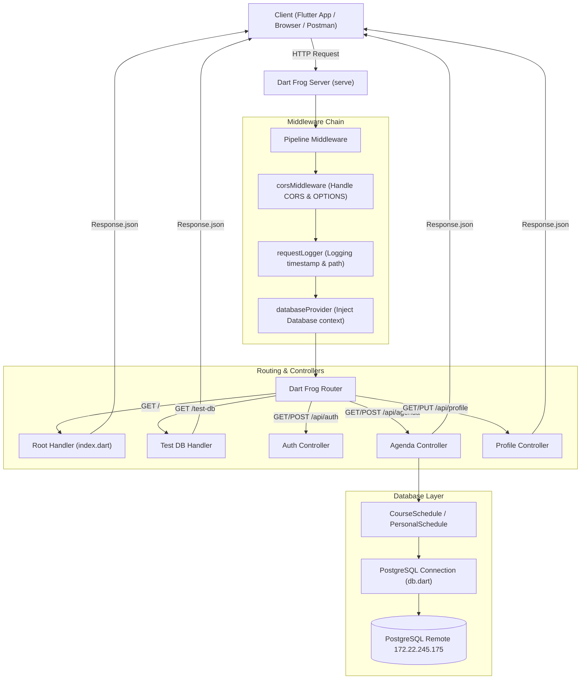

# Arsitektur Backend Dart Frog & PostgreSQL (Impal-02-07)

Dokumen ini mendokumentasikan spesifikasi arsitektur backend REST API berbasis **Dart Frog** (`package:dart_frog`), cara kerjanya, alur *lifecycle* request-response, koneksi ke database PostgreSQL, serta integrasinya dengan sistem *smart schedule*.

---

## 1. Ringkasan & Latar Belakang

- **Nama Project**: TodoList Smart System (Impal-02-07)
- **Framework Backend**: Dart Frog (`^1.2.6`)
- **Database Server**: PostgreSQL 15+ (`package:postgres: ^3.6.0`)
- **Pemilik Domain**: Yoga Perkasa Didik (103072400106)
  - Modul: **Auth (`auth`)**, **Agenda/Jadwal (`agenda`)**, **Profile (`profile`)**, **Database Connection & Architecture**.
- **Hubungan dengan Isar DB (Frontend)**:
  - Isar DB adalah database lokal offline-first di perangkat Flutter (domain Habindra).
  - Dart Frog adalah server REST API online di remote server (domain Yoga).
  - Keduanya terpisah dan berkomunikasi secara murni melalui protokol HTTP REST API standar menggunakan format JSON envelope.

---

## 2. Cara Kerja Dart Frog

Dart Frog adalah framework backend modern untuk bahasa Dart yang dirancang oleh Very Good Ventures. Dart Frog berjalan di atas engine HTTP asynchronous Dart dan Shelf, namun menambahkan lapisan abstraksi yang elegan untuk routing, dependensi (*provider*), dan format respon JSON.

### 2.1 Alur Siklus Hidup Permintaan (Request-Response Lifecycle)



### 2.2 Komponen Inti Dart Frog

1. **`RequestContext` (Konteks Permintaan)**
   - Objek yang dikirimkan ke setiap route handler dan middleware.
   - Berisi properti `context.request` (metode HTTP, URI, headers, body) dan state request.
   - Menjadi media untuk membaca objek yang di-injeksi menggunakan `context.read<T>()` atau menambahkan objek baru dengan `context.provide<T>(() => value)`.

2. **`Response.json(...)` (Respon JSON Otomatis)**
   - Fungsi bawaan Dart Frog yang otomatis mengonversi `Map<String, dynamic>` atau `List` menjadi string JSON, serta otomatis mengatur header `Content-Type: application/json; charset=utf-8`.
   - Mengeliminasi kebutuhan menulis manual `jsonEncode(...)` dan `headers: {'Content-Type': 'application/json'}`.
   - Contoh:
     ```dart
     return Response.json(
       statusCode: HttpStatus.ok,
       body: {
         'status': 'success',
         'message': 'Data berhasil diambil',
         'data': payload,
       },
     );
     ```

3. **`provider<T>` (Dependency Injection)**
   - Middleware Dart Frog yang menginjeksi sebuah service (misalnya koneksi database atau auth context) ke dalam `RequestContext`.
   - Handler mana pun di downstream dapat mengakses instance tersebut dengan memanggil:
     ```dart
     final db = context.read<Database>();
     ```

4. **`Router` dan File-Based Routing**
   - Mendukung dua mode pengoperasian:
     1. **Programmatic Router** di `bin/server.dart`: Memudahkan deployment dan eksekusi langsung via `dart run bin/server.dart` tanpa dependensi CLI tambahan.
     2. **File-based Routing** di direktori `routes/`: Format resmi Dart Frog (`routes/index.dart`, `routes/_middleware.dart`, dsb.) yang mendukung perintah `dart_frog dev`.

5. **Interoperabilitas Shelf (`fromShelfHandler` & `fromShelfMiddleware`)**
   - Memungkinkan sub-router Shelf yang sudah ada (seperti `AuthRoutes`, `AgendaRoutes`, `ProfileRoutes`) untuk diintegrasikan secara langsung ke router Dart Frog tanpa perlu menulis ulang seluruh controller dari awal.

---

## 3. Struktur Direktori Backend

```text
backend/
├── .env                              # Konfigurasi HOST, PORT, DB credentials, JWT secret
├── bin/
│   └── server.dart                   # Entry point server Dart Frog
├── routes/                           # Canonical file-based routes Dart Frog
│   ├── _middleware.dart              # Global middleware (CORS, Logger, Database Provider)
│   ├── index.dart                    # GET / -> Status & overview API
│   ├── test_db.dart                  # GET /test-db -> Cek koneksi PostgreSQL
│   └── tables.dart                   # GET /tables -> Daftar tabel aktif PostgreSQL
├── lib/
│   ├── config/
│   │   └── db.dart                   # PostgreSQL Connection Pool & Dialect Query normalizer
│   ├── controllers/                  # Logika bisnis controller
│   │   ├── agenda/agenda_controller.dart
│   │   ├── auth/auth_controller.dart
│   │   └── profile/profile_controller.dart
│   ├── middleware/                   # Middleware custom Dart Frog
│   │   ├── cors_middleware.dart      # Header CORS untuk Flutter Web & Client
│   │   ├── database_provider.dart    # DI provider Database ke RequestContext
│   │   └── auth/auth_middleware.dart # Verifikasi Bearer JWT Token
│   ├── models/                       # Entity models & query database PostgreSQL
│   │   ├── agenda/                   # course_schedule.dart, personal_schedule.dart
│   │   ├── auth/                     # user_model.dart, student_model.dart
│   │   └── profile/                  # profile_model.dart
│   └── routes/                       # Sub-router per domain
│       ├── agenda/agenda_routes.dart
│       ├── auth/auth_routes.dart
│       └── profile/profile_routes.dart
└── pubspec.yaml                      # Dependensi dart_frog (^1.2.6), postgres (^3.6.0), dll.
```

---

## 4. Cara Dart Frog Terhubung ke PostgreSQL

Koneksi database dikelola melalui kelas `Database` di `lib/config/db.dart`:

1. **Inisialisasi Lingkungan**:
   - Membaca file `.env` untuk mengambil konfigurasi kredensial:
     - `DB_HOST`: Alamat IP database server (default: `172.22.245.175`).
     - `DB_PORT`: Port database (default: `5432`).
     - `DB_NAME`: Nama database (`db_manajemen_tugas`).
     - `DB_USER`: Username (`Todolist_Dev`).
     - `DB_PASSWORD`: Password server.
     - `DB_SSL`: Mode SSL (`false` / `disable`).

2. **Koneksi Asynchronous & Reconnect Otomatis**:
   - `Connection.open(Endpoint(...), settings: ConnectionSettings(sslMode: SslMode.disable))` membuka channel socket TCP non-blocking ke server PostgreSQL.
   - Jika koneksi terputus saat aplikasi berjalan, fungsi `Database.query` mendeteksi galat soket dan melakukan *reconnect* otomatis secara transparan.

3. **Normalisasi Dialek & Parameterized Queries**:
   - Mendukung parameterized query bertipe `@parameter` untuk mencegah celah keamanan SQL Injection.
   - Menjamin kompatibilitas tipe data waktu PostgreSQL (`Time(HH:MM:SS.mmm)`) dan tanggal (`Date(YYYY-MM-DD)`).

---

## 5. Cara Menjalankan & Menguji Backend

### 5.1 Menjalankan Server

Dari direktori backend (`TodoList/Impal-02-07/backend`), jalankan:

```bash
dart run bin/server.dart
```

Output konsol ketika server berhasil berjalan:
```text
========================================================
🚀 Backend Dart Frog berjalan di http://localhost:3000
📊 Test DB : http://localhost:3000/test-db
📋 Tabel   : http://localhost:3000/tables
🔐 Auth    : http://localhost:3000/api/auth/login
📅 Jadwal  : http://localhost:3000/api/agenda
📅 Kuliah  : http://localhost:3000/api/agenda/course
📅 Personal: http://localhost:3000/api/agenda/personal
👤 Profil  : http://localhost:3000/api/profile
👤 User    : http://localhost:3000/api/user
========================================================
```

### 5.2 Header Respon Dart Frog

Setiap respon dari backend Dart Frog secara otomatis menyertakan header verifikasi:
```http
X-Powered-By: Dart with package:dart_frog
Content-Type: application/json; charset=utf-8
```

---

## 6. Format Envelope Respon API

Semua endpoint Dart Frog menggunakan envelope JSON seragam:

### Respon Sukses (200 OK / 201 Created)
```json
{
  "status": "success",
  "message": "Deskripsi pesan keberhasilan",
  "data": { ... }
}
```

### Respon Galat (400 Bad Request / 401 Unauthorized / 500 Internal Error)
```json
{
  "status": "error",
  "message": "Pesan deskripsi kesalahan"
}
```

