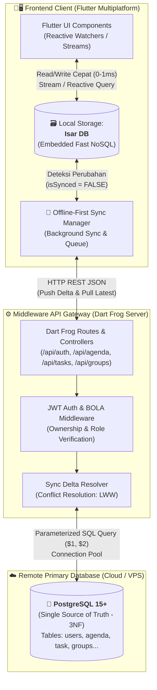

# 🗄️ Database Requirements & Hybrid Storage Specification
**Project: Smart System Todolist (Personal & Collaborative Management with Fuzzy Recommender)**

> [!INFO] Dasar Perancangan & Keselarasan Model
> Spesifikasi kebutuhan basis data ini disusun berdasarkan:
> 1. **Class Diagram (`Class_Diagram.md`)** & **Kamus Istilah (`kamus.md`)**
> 2. **Entity Relationship Diagram 3NF (`Entity_Relationship_Diagram.md`)**
> 3. **Activity Diagram (`Activity_Diagram.md`)** & **Use Case Diagram (`Use_Case_Diagram.md`)**
> 
> Arsitektur data menerapkan pola **Offline-First Hybrid Data Architecture**:
> * **Local Storage (Frontend Client):** **Isar DB** (Embedded NoSQL database cepat berbasis memory-mapped file/MDBX di dalam perangkat Android/Windows).
> * **API Middleware (Backend Server):** **Dart Frog** (HTTP server responsif yang menangani route, autentikasi JWT, validasi bisnis, dan sinkronisasi data).
> * **Remote Primary Database (Online Server):** **PostgreSQL** (*Single Source of Truth* / SSOT relasional dengan integritas ACID, foreign key constraints, dan backup terpusat).
> * **Standar Penamaan Entitas Universal:** Pengguna aplikasi menggunakan entitas **`User` (`users`)** dan kelompok kolaboratif menggunakan entitas **`Group` (`groups`)**.

---

## 1. Arsitektur Aliran Data Hybrid (Offline-First)

Aplikasi dirancang agar tetap dapat berfungsi optimal meskipun pengguna berada di area tanpa sinyal internet (misalnya di basement laboratorium atau area pedalaman).



---

## 2. Matriks Pemetaan Entitas: Local (Isar DB) vs Remote (PostgreSQL)

Berikut adalah pembagian peran penyimpanan untuk setiap entitas yang didefinisikan pada ERD dan Class Diagram:

| No | Entitas (Class / Tabel) | Simpan di Isar DB (Local)? | Simpan di PostgreSQL (Remote)? | Klasifikasi & Alasan Arsitektural |
|:--:|:---|:---:|:---:|:---|
| **1** | **`users` (Profil & Akun User)** | **Ya** *(Subset Profil)* | **Ya** *(Full Data & Kredensial)* | **Hybrid**. PostgreSQL menyimpan seluruh data termasuk hash kata sandi (`password_hash`) dan timestamps. Isar DB **HANYA** menyimpan cache sesi pengguna aktif (`id_user`, `name`, `email`) untuk auto-login dan tampilan profil offline. *Kata sandi tidak pernah disimpan di Isar!* |
| **2** | **`course` (Mata Kuliah / Modul)** | **Ya** *(Cache Lookup)* | **Ya** *(Master Data)* | **Hybrid**. Daftar mata kuliah/modul pelatihan yang diambil user dicache di Isar agar saat membuat jadwal/tugas offline, dropdown langsung tersedia seketika tanpa loading. |
| **3** | **`agenda` (Superclass Timeline)** | **Ya** *(Local Collection)* | **Ya** *(Tabel Superclass 3NF)* | **Hybrid**. Menyimpan atribut dasar waktu (`start_time`, `end_time`, `title`, `agenda_type`). Wajib ada di lokal agar kalender harian (`viewDailyAgenda`) bekerja offline. |
| **4** | **`course_schedule` (Jadwal Rutin)** | **Ya** *(Full Offline)* | **Ya** *(Relasional 3NF)* | **Hybrid**. User harus bisa mengecek ruangan dan jam sesi mingguan tanpa ketergantungan internet. Sinkronisasi dua arah. |
| **5** | **`personal_schedule` (Jadwal Pribadi)** | **Ya** *(Full Offline)* | **Ya** *(Relasional 3NF)* | **Hybrid**. Agenda kegiatan personal/organisasi/janji temu. Mendukung pembuatan dan pengeditan saat offline, lalu sinkronisasi otomatis ke cloud. |
| **6** | **`task` (Tugas Personal & Fuzzy)** | **Ya** *(Full Offline-First)* | **Ya** *(Primary SSOT)* | **Hybrid (Core Entity)**. Seluruh atribut tugas, bobot nilai, tenggat waktu, dan skor prioritas fuzzy disimpan di Isar untuk sorting lokal responsif, dan dicadangkan penuh di PostgreSQL. |
| **7** | **`todo_item` (Checklist Harian)** | **Ya** *(Full Offline-First)* | **Ya** *(Relasional 3NF)* | **Hybrid**. Item to-do harian bersifat personal dan membutuhkan interaksi instan (*toggle checkbox* tanpa lag jaringan). Disimpan lokal dan disinkronkan saat terhubung internet. |
| **8** | **`notification` (Notifikasi & Alert)** | **Ya** *(Cache Riwayat)* | **Ya** *(Log Historis Server)* | **Hybrid**. Riwayat pesan pengingat tenggat waktu disimpan di PostgreSQL sebagai audit log dan dicache di Isar agar pengguna tetap bisa membaca riwayat saat offline. |
| **9** | **`groups` (Kelompok / Tim)** | **Ya** *(Cache Tim Saya)* | **Ya** *(Master Data Tim)* | **Hybrid (Server-Authoritative)**. User menyimpan cache tim yang diikutinya di Isar. Namun, pembuatan tim baru atau verifikasi kode undangan (`invite_code`) wajib divalidasi ke server PostgreSQL via Dart Frog. |
| **10** | **`group_member` (Anggota Tim)** | **Ya** *(Cache Anggota Tim)* | **Ya** *(Tabel Pivot M:N)* | **Hybrid (Read-Heavy Local)**. Menyimpan daftar nama dan role (`LEADER`/`MEMBER`) rekan tim di Isar untuk render kartu anggota tim secara cepat. Perubahan hak akses diatur oleh server. |
| **11** | **`meeting_schedule` (Rapat Tim)** | **Ya** *(Cache Kalender Tim)* | **Ya** *(Jadwal Bersama)* | **Hybrid**. Jadwal rapat tim dicache di Isar agar anggota tim tahu agenda sinkronisasi berikutnya dan tautan platform/ruangan. |
| **12** | **`group_task` (Tugas Besar Tim)** | **Ya** *(Cache Tugas Tim)* | **Ya** *(Pusat Kolaborasi)* | **Hybrid**. Disimpan di Isar untuk monitoring progres kelompok offline. Penunjukan PIC (`assignPIC`) disinkronkan ke seluruh anggota melalui PostgreSQL. |
| **13** | **`group_sub_task` (Sub-Tugas Anggota)**| **Ya** *(Local Work Unit)* | **Ya** *(Tabel Rincian)* | **Hybrid**. Setiap anggota dapat melihat dan menandai selesai sub-tugas yang didelegasikan kepadanya, lalu di-push ke server untuk mengupdate persentase akumulasi bobot kelompok. |

---

## 3. Aturan Batasan Data (Data Boundary & Security Rule)

Terdapat data spesifik yang **DILARANG KERAS** disimpan di Local Storage (Isar DB):
1. **Password Hash (`password_hash`):**
   * *Alasan:* Local storage pada perangkat mobile dapat diekstrak jika perangkat di-*root* atau diexploit. Password hash Bcrypt **hanya boleh ada di PostgreSQL**.
   * *Mekanisme:* Frontend hanya menyimpan token JWT yang aman (disimpan di `flutter_secure_storage`).
2. **Master User Seluruh Sistem:**
   * *Alasan:* Database lokal hanya menyimpan profil milik user yang sedang aktif login di perangkat tersebut. Pencarian anggota tim lain dilakukan melalui query online ke Dart Frog endpoint (`GET /api/user/search?q=...`).
3. **Log Audit Server & System Traces:**
   * *Alasan:* Log error server, jejak aktivitas sistem, dan token revocation list hanya dikelola di sisi backend.

---

## 4. Spesifikasi Struktur Isar DB (Local NoSQL Schema di Flutter)

Setiap skema koleksi di Isar DB menambahkan **4 Metadata Field Standar Sinkronisasi**:
* `Id id = Isar.autoIncrement;` $\rightarrow$ ID numerik internal Isar untuk indexing lokal berkecepatan tinggi.
* `@Index(unique: true) String remoteId;` $\rightarrow$ Menyimpan ID relasional UUID v4 yang cocok dengan Primary Key di PostgreSQL (`id_task`, `id_agenda`, dll).
* `DateTime updatedAt;` $\rightarrow$ Waktu pembaruan data untuk mekanisme resolusi konflik *Last-Write-Wins* (LWW).
* `bool isSynced;` $\rightarrow$ Berisi `true` jika data sudah sama dengan PostgreSQL; bernilai `false` jika data baru dibuat/diubah saat offline.
* `String? syncAction;` $\rightarrow$ Status aksi sinkronisasi: `'INSERT'`, `'UPDATE'`, `'DELETE'`.

### A. Contoh Model Koleksi Isar: `TaskCollection`
```dart
import 'package:isar/isar.dart';

part 'task_collection.g.dart';

@collection
class TaskCollection {
  Id id = Isar.autoIncrement; // Local fast ID

  @Index(unique: true)
  late String remoteId; // id_task (UUID v4 di PostgreSQL)

  late String idUser;
  late String courseCode;
  late String taskTitle;
  String? description;
  late DateTime deadline;
  late double gradeWeight;
  late double priorityScore;
  late String priority; // 'VERY HIGH', 'HIGH', 'MEDIUM', 'LOW'
  late bool isFuzzyAuto;
  late bool isCompleted;

  // Metadata Sinkronisasi
  late DateTime updatedAt;
  late bool isSynced;
  String? syncAction; // 'INSERT', 'UPDATE', 'DELETE'
}
```

### B. Contoh Model Koleksi Isar: `AgendaCollection`
```dart
import 'package:isar/isar.dart';

part 'agenda_collection.g.dart';

@collection
class AgendaCollection {
  Id id = Isar.autoIncrement;

  @Index(unique: true)
  late String remoteId; // id_agenda (UUID v4)

  late String idUser;
  late String title;
  late String startTime; // '08:00:00'
  late String endTime;   // '10:30:00'
  late String agendaType; // 'COURSE' atau 'PERSONAL'

  // Spesialisasi CourseSchedule
  String? courseCode;
  String? day;
  String? room;

  // Spesialisasi PersonalSchedule
  DateTime? date;
  String? category;
  String? location;
  String? notes;

  // Metadata Sinkronisasi
  late DateTime updatedAt;
  late bool isSynced;
  String? syncAction;
}
```

---

## 5. Spesifikasi Struktur PostgreSQL (Remote Relational DDL di Server)

Skema PostgreSQL menggunakan bentuk jamak (`users`, `groups`) untuk menghindari bentrok dengan kata kunci cadangan (*reserved keyword*) SQL.

```sql
-- ============================================================================
-- 1. EXTENSIONS & ENUMS
-- ============================================================================
CREATE EXTENSION IF NOT EXISTS "uuid-ossp";

-- ============================================================================
-- 2. TABEL: users (Akun & Profil Pengguna)
-- ============================================================================
CREATE TABLE users (
    id_user VARCHAR(50) PRIMARY KEY,
    name VARCHAR(100) NOT NULL,
    email VARCHAR(100) UNIQUE NOT NULL,
    password_hash VARCHAR(255) NOT NULL,
    created_at TIMESTAMP WITH TIME ZONE DEFAULT CURRENT_TIMESTAMP,
    updated_at TIMESTAMP WITH TIME ZONE DEFAULT CURRENT_TIMESTAMP
);

-- ============================================================================
-- 3. TABEL: course (Master Data Mata Kuliah / Pelatihan)
-- ============================================================================
CREATE TABLE course (
    course_code VARCHAR(20) PRIMARY KEY,
    course_name VARCHAR(100) NOT NULL,
    credits INT NOT NULL CHECK (credits > 0),
    lecturer VARCHAR(100) NOT NULL,
    created_at TIMESTAMP WITH TIME ZONE DEFAULT CURRENT_TIMESTAMP
);

-- ============================================================================
-- 4. HIERARKI AGENDA (Class Table Inheritance)
-- ============================================================================
-- Superclass: agenda
CREATE TABLE agenda (
    id_agenda VARCHAR(50) PRIMARY KEY,
    id_user VARCHAR(50) NOT NULL REFERENCES users(id_user) ON DELETE CASCADE,
    title VARCHAR(150) NOT NULL,
    start_time TIME NOT NULL,
    end_time TIME NOT NULL,
    agenda_type VARCHAR(20) NOT NULL CHECK (agenda_type IN ('COURSE', 'PERSONAL')),
    created_at TIMESTAMP WITH TIME ZONE DEFAULT CURRENT_TIMESTAMP,
    updated_at TIMESTAMP WITH TIME ZONE DEFAULT CURRENT_TIMESTAMP
);

-- Subclass: course_schedule (Jadwal Rutin Mingguan)
CREATE TABLE course_schedule (
    id_agenda VARCHAR(50) PRIMARY KEY REFERENCES agenda(id_agenda) ON DELETE CASCADE,
    course_code VARCHAR(20) NOT NULL REFERENCES course(course_code) ON DELETE RESTRICT,
    day VARCHAR(20) NOT NULL CHECK (day IN ('Senin', 'Selasa', 'Rabu', 'Kamis', 'Jumat', 'Sabtu', 'Minggu')),
    room VARCHAR(50) NOT NULL
);

-- Subclass: personal_schedule (Jadwal Kegiatan Pribadi)
CREATE TABLE personal_schedule (
    id_agenda VARCHAR(50) PRIMARY KEY REFERENCES agenda(id_agenda) ON DELETE CASCADE,
    date DATE NOT NULL,
    category VARCHAR(50) NOT NULL,
    location VARCHAR(100),
    notes TEXT
);

-- ============================================================================
-- 5. TABEL: task (Tugas Personal dengan Prioritas Fuzzy)
-- ============================================================================
CREATE TABLE task (
    id_task VARCHAR(50) PRIMARY KEY,
    id_user VARCHAR(50) NOT NULL REFERENCES users(id_user) ON DELETE CASCADE,
    course_code VARCHAR(20) NOT NULL REFERENCES course(course_code) ON DELETE RESTRICT,
    task_title VARCHAR(150) NOT NULL,
    description TEXT,
    deadline TIMESTAMP WITH TIME ZONE NOT NULL,
    grade_weight FLOAT NOT NULL DEFAULT 0.0 CHECK (grade_weight >= 0.0 AND grade_weight <= 100.0),
    priority_score FLOAT NOT NULL DEFAULT 0.0 CHECK (priority_score >= 0.0 AND priority_score <= 100.0),
    priority VARCHAR(20) NOT NULL DEFAULT 'MEDIUM' CHECK (priority IN ('VERY HIGH', 'HIGH', 'MEDIUM', 'LOW')),
    is_fuzzy_auto BOOLEAN NOT NULL DEFAULT TRUE,
    is_completed BOOLEAN NOT NULL DEFAULT FALSE,
    created_at TIMESTAMP WITH TIME ZONE DEFAULT CURRENT_TIMESTAMP,
    updated_at TIMESTAMP WITH TIME ZONE DEFAULT CURRENT_TIMESTAMP
);

-- ============================================================================
-- 6. TABEL: todo_item (Item Checklist Harian)
-- ============================================================================
CREATE TABLE todo_item (
    id_item VARCHAR(50) PRIMARY KEY,
    id_user VARCHAR(50) NOT NULL REFERENCES users(id_user) ON DELETE CASCADE,
    activity_title VARCHAR(150) NOT NULL,
    notes TEXT,
    date DATE NOT NULL,
    is_done BOOLEAN NOT NULL DEFAULT FALSE,
    created_at TIMESTAMP WITH TIME ZONE DEFAULT CURRENT_TIMESTAMP,
    updated_at TIMESTAMP WITH TIME ZONE DEFAULT CURRENT_TIMESTAMP
);

-- ============================================================================
-- 7. TABEL: notification (Riwayat Pengingat & Alert)
-- ============================================================================
CREATE TABLE notification (
    id_notification VARCHAR(50) PRIMARY KEY,
    id_user VARCHAR(50) NOT NULL REFERENCES users(id_user) ON DELETE CASCADE,
    id_task VARCHAR(50) REFERENCES task(id_task) ON DELETE SET NULL,
    message_title VARCHAR(100) NOT NULL,
    message TEXT NOT NULL,
    sent_time TIMESTAMP WITH TIME ZONE NOT NULL DEFAULT CURRENT_TIMESTAMP,
    is_read BOOLEAN NOT NULL DEFAULT FALSE,
    created_at TIMESTAMP WITH TIME ZONE DEFAULT CURRENT_TIMESTAMP
);

-- ============================================================================
-- 8. MODUL KOLABORATIF (Kelompok / Tim & Rapat)
-- ============================================================================
-- Kelompok / Tim: groups
CREATE TABLE groups (
    id_group VARCHAR(50) PRIMARY KEY,
    id_leader VARCHAR(50) NOT NULL REFERENCES users(id_user) ON DELETE RESTRICT,
    group_name VARCHAR(100) NOT NULL,
    description TEXT,
    invite_code VARCHAR(20) UNIQUE NOT NULL,
    created_at TIMESTAMP WITH TIME ZONE DEFAULT CURRENT_TIMESTAMP,
    updated_at TIMESTAMP WITH TIME ZONE DEFAULT CURRENT_TIMESTAMP
);

-- Anggota Kelompok: group_member (Tabel Pivot M:N)
CREATE TABLE group_member (
    id_member VARCHAR(50) PRIMARY KEY,
    id_group VARCHAR(50) NOT NULL REFERENCES groups(id_group) ON DELETE CASCADE,
    id_user VARCHAR(50) NOT NULL REFERENCES users(id_user) ON DELETE CASCADE,
    role VARCHAR(20) NOT NULL DEFAULT 'MEMBER' CHECK (role IN ('LEADER', 'MEMBER')),
    joined_at TIMESTAMP WITH TIME ZONE DEFAULT CURRENT_TIMESTAMP,
    CONSTRAINT uq_group_user UNIQUE (id_group, id_user)
);

-- Jadwal Rapat Kelompok: meeting_schedule
CREATE TABLE meeting_schedule (
    id_meeting VARCHAR(50) PRIMARY KEY,
    id_group VARCHAR(50) NOT NULL REFERENCES groups(id_group) ON DELETE CASCADE,
    meeting_title VARCHAR(150) NOT NULL,
    description TEXT,
    start_time TIMESTAMP WITH TIME ZONE NOT NULL,
    platform_location VARCHAR(150) NOT NULL,
    created_at TIMESTAMP WITH TIME ZONE DEFAULT CURRENT_TIMESTAMP
);

-- ============================================================================
-- 9. TUGAS BESAR KELOMPOK & SUB-TUGAS
-- ============================================================================
-- Tugas Utama Kelompok: group_task
CREATE TABLE group_task (
    id_group_task VARCHAR(50) PRIMARY KEY,
    id_group VARCHAR(50) NOT NULL REFERENCES groups(id_group) ON DELETE CASCADE,
    id_assigned_to VARCHAR(50) REFERENCES users(id_user) ON DELETE SET NULL, -- PIC
    task_title VARCHAR(150) NOT NULL,
    description TEXT,
    deadline TIMESTAMP WITH TIME ZONE NOT NULL,
    grade_weight FLOAT NOT NULL DEFAULT 0.0,
    priority VARCHAR(20) NOT NULL DEFAULT 'MEDIUM',
    is_fuzzy_auto BOOLEAN NOT NULL DEFAULT FALSE,
    is_completed BOOLEAN NOT NULL DEFAULT FALSE,
    created_at TIMESTAMP WITH TIME ZONE DEFAULT CURRENT_TIMESTAMP,
    updated_at TIMESTAMP WITH TIME ZONE DEFAULT CURRENT_TIMESTAMP
);

-- Sub-Tugas Individu: group_sub_task
CREATE TABLE group_sub_task (
    id_sub_task VARCHAR(50) PRIMARY KEY,
    id_group_task VARCHAR(50) NOT NULL REFERENCES group_task(id_group_task) ON DELETE CASCADE,
    id_assigned_to VARCHAR(50) NOT NULL REFERENCES users(id_user) ON DELETE CASCADE, -- Anggota pelaksana
    sub_task_title VARCHAR(150) NOT NULL,
    description TEXT,
    deadline TIMESTAMP WITH TIME ZONE NOT NULL,
    grade_weight FLOAT NOT NULL DEFAULT 0.0 CHECK (grade_weight >= 0.0 AND grade_weight <= 100.0),
    is_completed BOOLEAN NOT NULL DEFAULT FALSE,
    created_at TIMESTAMP WITH TIME ZONE DEFAULT CURRENT_TIMESTAMP,
    updated_at TIMESTAMP WITH TIME ZONE DEFAULT CURRENT_TIMESTAMP
);

-- ============================================================================
-- 10. INDEXING PERFORMA
-- ============================================================================
CREATE INDEX idx_task_user_deadline ON task(id_user, deadline);
CREATE INDEX idx_agenda_user_time ON agenda(id_user, start_time, end_time);
CREATE INDEX idx_group_member_user ON group_member(id_user);
CREATE INDEX idx_group_task_group ON group_task(id_group);
CREATE INDEX idx_sub_task_assigned ON group_sub_task(id_assigned_to);
```

---

## 6. Protokol Sinkronisasi Isar DB $\leftrightarrow$ Dart Frog $\leftrightarrow$ PostgreSQL

### A. Alur Operasi Pengguna Saat Offline (Write-Path)
1. Pengguna membuat atau mengubah data (misal: membuat tugas baru pada saat offline).
2. Frontend membuat record di **Isar DB**:
   * Menghasilkan `remoteId` lokal menggunakan format UUID v4 (`uuid.v4()`).
   * Menetapkan `isSynced = false` dan `syncAction = 'INSERT'`.
3. UI langsung merespons seketika (**latensi 0ms**), tugas baru langsung muncul pada daftar.
4. Ketika perangkat kembali mendeteksi sinyal internet (*connectivity change listener*):
   * Background Sync Manager mengambil semua record yang berstatus `isSynced == false`.
   * Melakukan HTTP POST/PUT ke rute **Dart Frog** (`POST /api/tasks/sync`).
   * Dart Frog memvalidasi token JWT dan menyimpan payload ke **PostgreSQL**.
   * Setelah server mengembalikan respon HTTP 200 OK, Isar DB mengupdate status record menjadi `isSynced = true` dan `syncAction = null`.

### B. Alur Pengambilan Data Terbaru (Read-Path / Cache-First)
1. Saat halaman dibuka, UI membaca data langsung dari **Isar DB** menggunakan watcher stream (`taskCollection.where().watch()`). Pengguna tidak pernah melihat *loading spinner* kosong.
2. Di latar belakang, Frontend mengirimkan request ke Dart Frog:
   ```http
   GET /api/tasks?last_sync=2026-11-12T10:00:00Z
   ```
3. Dart Frog mengambil perubahan data di **PostgreSQL** yang memiliki `updated_at > last_sync`.
4. Frontend menerima delta data terbaru, memperbarui koleksi **Isar DB**, dan UI otomatis ter-refresh secara reaktif melalui watcher stream.

### C. Strategi Resolusi Konflik (Conflict Resolution)
* **Untuk Entitas Personal (`task`, `agenda`, `todo_item`):**
  Menggunakan aturan **Last-Write-Wins (LWW)** berdasarkan nilai field `updated_at`. Jika terdapat perbedaan antara lokal dan server, nilai `updated_at` yang paling akhir akan dijadikan acuan.
* **Untuk Entitas Kolaboratif Kelompok (`groups`, `group_task`, `group_sub_task`):**
  Menggunakan pendekatan **Server-Authoritative**. Jika terjadi perbedaan status atau bentrok edit tugas kelompok antar dua anggota tim yang berbeda, data di server PostgreSQL adalah penentu mutlak untuk menjaga konsistensi tim.

---

## 7. Rangkuman Kesimpulan Database Requirement

| Parameter | Sisi Frontend (Local Storage) | Sisi Backend (Primary Storage) |
|:---|:---|:---|
| **Teknologi** | **Isar DB** (Flutter Embedded NoSQL) | **PostgreSQL 15+** (Relational Database) |
| **Konektor** | Isar Native Binary Driver (Dart C-FFI / MDBX) | `postgres: ^3.6.0` Pool via Dart Frog |
| **Peran Utama** | Cache lokal, offline-first, latency 0ms, reaktif | Single source of truth, audit trail, relasi 3NF, multi-user sync |
| **Data yang Disimpan** | Task, Agenda, To-Do, Cache Profil, Cache Tim | Seluruh 13 entitas, hash password, relational constraint |
| **Strategi Sinkronisasi** | Push-Pull Delta Sync dengan flag `isSynced` | REST API via Dart Frog Controllers |

---

## 8. Spesifikasi Arsitektur Backend API (Dart Frog & PostgreSQL)

1. **Framework Resmi**: **Dart Frog** (`dart_frog`) digunakan sebagai standar framework backend RESTful API.
2. **Koneksi Database Remote**: Menggunakan driver resmi `postgres: ^3.6.0` yang terhubung ke instance PostgreSQL server (`172.22.245.175:5432`) dengan database `db_manajemen_tugas`.
3. **Standar Format Response (JSON Envelope)**:
   Seluruh endpoint mengembalikan format response standar yang konsisten:
   ```json
   {
     "status": "success" | "error",
     "message": "Pesan deskripsi operasional",
     "data": {} // Objek tunggal atau array data
   }
   ```
4. **Middleware & Otentikasi**:
   - JWT Bearer Token Middleware untuk validasi sesi dan ekstraksi identitas (`idUser`, `email`).
   - Proteksi BOLA (Broken Object Level Authorization) pada seluruh operasi mutasi (Create, Update, Delete) untuk memastikan user hanya dapat mengakses atau memodifikasi data miliknya sendiri.
5. **Konvensi Modularitas Endpoint**:
   - `/api/auth` $\rightarrow$ Registrasi, Login, Forgot Password, Reset Password.
   - `/api/agenda` $\rightarrow$ Manajemen Jadwal (Lecture, Meeting, External).
   - `/api/profile` / `/api/user` $\rightarrow$ Manajemen Akun & Profil Pengguna.
   - `/api/tasks` $\rightarrow$ Manajemen Tugas & Prioritas Fuzzy.
   - `/api/groups` $\rightarrow$ Manajemen Kelompok, Rapat Tim, & Sub-Tugas.

> [!NOTE]
> Untuk penjelasan mendalam mengenai cara kerja framework Dart Frog, *request-response lifecycle*, *dependency injection* via `provider<T>`, dan pengujian server, silakan merujuk ke dokumen: [DART_FROG_ARCHITECTURE.md](file:///D:/Telkom%20University/Semester%205/TodoList/Impal-02-07/document/DART_FROG_ARCHITECTURE.md) dan [.agents/features/backend_dart_frog_architecture.md](file:///D:/Telkom%20University/Semester%205/TodoList/Impal-02-07/.agents/features/backend_dart_frog_architecture.md).
